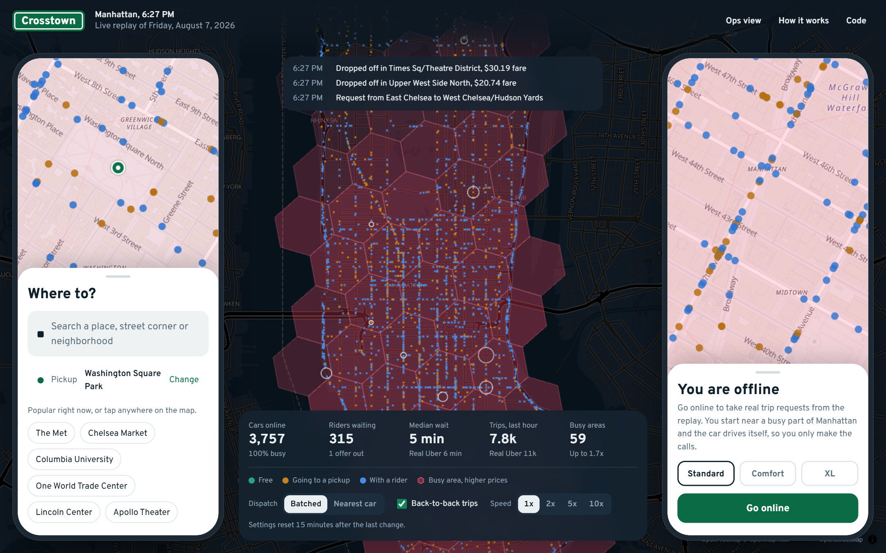
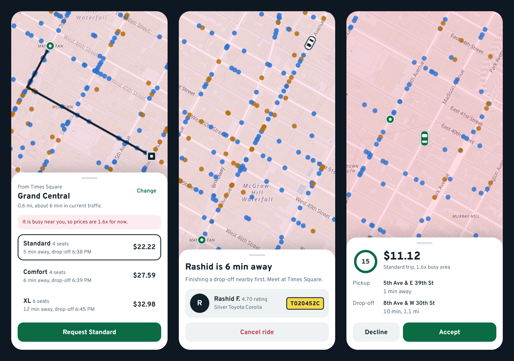
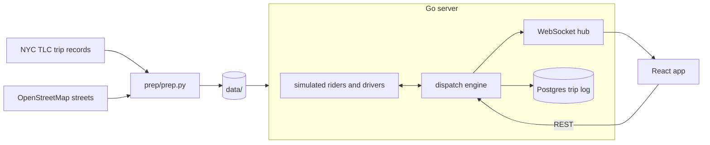

# Crosstown

Crosstown is a ride hailing system I built to understand how apps like Uber work behind the scenes. It replays one real day of Uber trips in Manhattan, Friday August 7, 2026, at the minute each request really happened. The cars are simulated and drive on the real street network, and you can join in as a rider or as a driver.

Live demo: https://adwitiyashukla-crosstown.hf.space



## What you can do

- Watch the control room. Every dot is a car, colored by what it is doing, and the feed shows requests, pickups and surge as they happen.
- Request a ride. Search for a place, pick Standard, Comfort or XL from three upfront prices, then follow your car until you get dropped off.
- Drive. Go online and take real requests from the replay. The car drives itself and you decide which offers to accept.
- Open the ops view to switch between batched matching and nearest car, turn back-to-back trips on or off, or speed up the clock.



## How it works



The server is a single Go binary. One goroutine owns the dispatch engine and the simulator, so the core logic has no locks, and HTTP handlers send their work to that goroutine over a channel. The engine is deterministic. The same seed and the same requests always give the same event log, which made bugs easy to reproduce.

### Data

`prep/prep.py` downloads the August 2026 high volume for-hire trip records from the NYC TLC and the Manhattan streets from OpenStreetMap, then writes the small files in `data/`. Manhattan had 3.48 million Uber trips that month and 138,236 of them on the replay day. The road graph keeps the largest strongly connected part of the drivable streets with one-way rules and speed limits, contracted down to 4,484 intersections and 9,683 road segments.

### Dispatch

Every 2 seconds the engine takes the open requests and looks for free drivers in the H3 hexagons around each pickup. For each request it runs one reverse Dijkstra on the road graph to get real driving times from up to 25 nearby drivers. Then it solves the whole batch at once with the Hungarian algorithm, so two riders never fight over the same car. A driver who is less than 3 minutes from a drop-off can also get the next ride right away (back-to-back). The simpler nearest car policy is still there to compare against. Offers expire after 15 seconds and the trip goes back into the next batch.

### Pricing and surge

Fares come from a median regression on all 3.48 million trips. The fit is $4.16 base, $0.75 per mile and $0.94 per minute with an $8.07 minimum. On top of that come the NYC sales tax, the Black Car Fund, the congestion surcharge south of 96th Street and the CBD toll. Surge works per H3 cell. When pickups in a cell keep taking longer than 6 minutes, its multiplier goes up in small steps, up to 3x. Quotes are signed with HMAC, so the price a rider saw is the price they pay. Every finished trip writes double entry ledger lines that add up to zero.

### Drivers and riders

There is no public data on how many Uber drivers are online, so the simulator plans a fleet from demand. It looks at the other three Fridays in August to see how busy a typical Friday is at each hour. When requests run above that plan for 15 minutes, more drivers log on. That matters on August 7, because demand jumped at 6 PM to 13,499 requests in one hour, about 70% more than a normal Friday. Riders compare the quote with what they really paid that day and some of them walk away, and they cancel if their car takes too long.

### Live map

Car positions go out over WebSockets as binary frames, 16 bytes per car, and each client only gets the hex cells its map is looking at. The browser animates the cars between frames and draws everything with deck.gl on top of MapLibre. Trips, events and ledger lines go to Postgres in batches with COPY.

## Results

The replay numbers come from `cmd/replay`. The engine is deterministic, so the same command gives the same numbers on any machine.

### A full day next to real Uber

| | Crosstown | Real Uber |
|---|---|---|
| Trips completed | 134,621 | 138,236 |
| Median wait for the car | 2.1 min | 3.1 min |
| 90th percentile wait | 8.1 min | 8.5 min |
| Median trip time | 14.1 min | 14.0 min |
| Median fare before fees | $20.49 | $19.95 |

The TLC records only list trips that happened, so every real rider in the data got a ride. In the replay 1,219 riders walked away at the quote and 2,070 cancelled while waiting. The replay follows the shape of the real day, but in quiet hours my cars reach riders about a minute faster than real Uber drivers. The 6 PM spike is the interesting part.

| Hour | Requests | Crosstown median wait | Real median wait |
|---|---|---|---|
| 5 PM | 8,120 | 1.9 min | 3.4 min |
| 6 PM | 13,499 | 6.7 min | 6.1 min |
| 7 PM | 11,636 | 6.0 min | 4.6 min |
| 8 PM | 7,588 | 1.8 min | 3.3 min |

Real fares jumped too. The real median fare between 6 and 7 PM was $30.84, so Uber surged much harder than my controller does ($21.32).

### Batched matching vs nearest car

The same evening, 4 PM to 9 PM, replayed with each dispatch policy:

| Policy | Completed | Median wait | 90th percentile wait | Empty driving | Walked away at the quote |
|---|---|---|---|---|---|
| Batched + back-to-back | 97.4% | 3.9 min | 10.1 min | 12.8% | 332 |
| Batched | 96.7% | 3.7 min | 9.6 min | 16.8% | 1,268 |
| Nearest car | 91.7% | 5.8 min | 15.2 min | 23.5% | 2,473 |
| Real Uber | | 4.3 min | 11.1 min | | |

Empty driving is the share of all driving spent on the way to a pickup. Nearest car does fine when the city is quiet, but during the spike its median wait climbs to 12 minutes, because the closest free car is often far away and every long pickup takes another car out of the pool. Back-to-back makes the median wait a little longer, since some riders wait for a car that is finishing another trip. In return more cars carry riders instead of driving empty, surge stays lower (1.09x against 1.19x on average) and about four times fewer riders walk away at the quote.

### Speed

I measured speed on a 2 vCPU cloud VM (Intel Xeon at 2.3 GHz), which is about the size of the free Hugging Face Space the demo runs on.

- The full day replay (138,236 riders and up to 3,960 cars) finishes in 2 minutes 24 seconds, about 600 times faster than real time.
- `cmd/loadgen` runs the 6 PM rush at 5x speed with 100 map viewers and 16 clients asking for quotes nonstop. Each viewer got a 50 KB frame about once a second (4.9 MB/s in total), the server answered 2,594 quotes per second with a p99 latency of 15 ms, and the engine tick stayed at 7.1 ms p99 against its 100 ms budget.
- In the benchmarks the Hungarian algorithm solves 50 riders against 200 drivers in 43 microseconds and 200 against 800 in 0.71 ms. Driving times from 25 drivers to one pickup take 90 microseconds, an A* route across Manhattan takes 0.14 ms, and a GPS update that moves a car to a new hex takes 0.8 microseconds.

## Run it

With Docker:

```
docker compose up --build
```

This starts Postgres and the app. Then open http://localhost:8080. The control room is at `/`, the ops view at `/ops`, and the phones at `/rider` and `/driver`. The server replays the 90 minutes before the current time before it starts listening, so the city is already busy when the page opens.

Without Docker you need Go 1.27, a C compiler for the H3 library (gcc, or MinGW on Windows) and Node 24:

```
cd web
npm ci
npm run build
cd ..
go run ./cmd/crosstown
```

The server runs fine without a database. Set `DATABASE_URL` to a Postgres connection string to keep the trip log. All settings live in `config.toml`.

Replay part of the day and compare policies:

```
go run ./cmd/replay -from 16:00 -to 21:00 -runs batch+b2b,batch,greedy -hourly
```

Rebuild the data from the raw files (the trip records are about 500 MB):

```
pip install -r prep/requirements.txt
python prep/prep.py fetch
python prep/prep.py build
```

## Tests

```
go test ./...
```

There are 49 tests. They cover the trip lifecycle, offers that expire or get declined, cancel fees, back-to-back offers, surge, signed quotes and idempotent requests. The Hungarian solver is checked against brute force and the routing against Bellman-Ford. A chaos test sends random commands to the engine and checks its invariants after every step, and another test replays the same hour twice and compares the event logs. The server tests go through the HTTP and WebSocket flows, and the Postgres test runs when `TEST_DATABASE_URL` is set. There are also fuzz targets for quote tokens and place search, and benchmarks for routing and matching. CI runs all of it with the race detector, builds the web app and boots the Docker image.

## Project layout

```
cmd/crosstown     the server
cmd/replay        offline replay and policy comparison
cmd/loadgen       load test with many map viewers and quote clients
internal/engine   dispatch, pricing, surge, ledger
internal/sim      simulated riders and drivers
internal/roads    road graph, routing, turn by turn directions
internal/city     data loading and place search
internal/server   HTTP API, WebSocket hub, runtime loop
internal/store    Postgres trip log
web               React app
prep              data preparation
```

## Credits

Trip data from the NYC Taxi and Limousine Commission. Map data from OpenStreetMap contributors under the ODbL. Map tiles from OpenFreeMap. Hex grid from H3.
